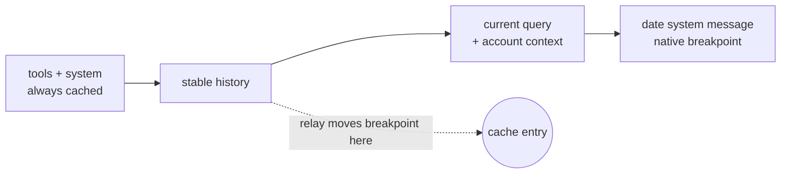

# OMP port

This branch (`omp-port`) runs the provider inside OMP
(`@oh-my-pi/pi-coding-agent`, verified with 18.10.2 and Claude Code 2.1.293)
instead of upstream Pi. The transport design is unchanged: one OMP model call
spawns one request-scoped `claude` process, and OMP executes every tool.

## Install

```sh
omp plugin link ~/workspace/omp-claude-directsdk
omp models claude-directsdk     # first run fills OMP's model cache
omp --model claude-directsdk/claude-haiku-5-5
```

Subagents use their role model. To run them through this provider, set
`modelRoles.task` or `task.agentModelOverrides.<agent>` in
`~/.omp/agent/config.yml` to a `claude-directsdk/...` model.

## What changed from upstream

| Area               | Upstream Pi                                                               | OMP port                                                                                                               |
| ------------------ | ------------------------------------------------------------------------- | ---------------------------------------------------------------------------------------------------------------------- |
| Registration       | `registerApiProvider` + `registerProvider(provider)` with `refreshModels` | `registerProvider(name, { api, streamSimple, fetchDynamicModels })`; OMP caches the catalog in SQLite for 24 h         |
| Context            | Transcript with system messages                                           | Raw OMP `Context`: `systemPrompt` sections joined, `tools` array                                                       |
| Thinking carrier   | `AssistantMessage.diagnostics`                                            | `AssistantMessage.providerPayload` (`type: "claudeDirectSdkNative"`)                                                   |
| Effort             | `thinkingLevelMap`                                                        | `thinking.efforts` on the model; OMP `minimal` maps to native `low`                                                    |
| Roles and blocks   | `user`, `assistant`, `toolResult`                                         | Also `developer` (replayed as user); OMP-only assistant blocks are dropped                                             |
| Tool names         | Rejects names outside `[A-Za-z0-9_-]{1,50}`                               | Stable hash alias for long or non-ASCII names; computer-use tools are skipped                                          |
| Auth env           | Refuses `ANTHROPIC_API_KEY`, `ANTHROPIC_BASE_URL`, backend switches       | Strips them from the child, so it can only use its own login; upstream is always `api.anthropic.com` outside test mode |
| Nested session env | Inherited                                                                 | Claude Code session markers (`CLAUDECODE`, `CLAUDE_CODE_SESSION_ID`, ...) are stripped                                 |
| Inert MCP runtime  | `process.execPath`                                                        | Same, plus `BUN_BE_BUN=1` because `omp` is a Bun single-file executable                                                |
| Child cwd          | One temp dir per process                                                  | Fixed `~/.cache/omp-claude-directsdk/cwd` so resumed sessions keep the cache prefix                                    |
| Cache breakpoints  | Native placement                                                          | Moved to stable history (see below)                                                                                    |

## API key protection

`ANTHROPIC_API_KEY` exported for other tools (for example through
`launchctl setenv`) makes a plain `claude` use API-key billing
(`authMethod: api_key`). The port blocks that at three layers:

1. `stripConflictingEnv` removes `ANTHROPIC_API_KEY`, `ANTHROPIC_AUTH_TOKEN`,
   `ANTHROPIC_BASE_URL`, `ANTHROPIC_FOUNDRY_API_KEY`, and the Bedrock, Vertex
   and Foundry switches from the request child and from the discovery probes,
   so the child logs in with its subscription (`authMethod: claude.ai`).
2. The relay forwards only requests authenticated by a subscription OAuth
   bearer (`Bearer sk-ant-oat…`). A request with `x-api-key` or any other
   credential gets a local 401 and nothing reaches upstream; the call fails
   with a logged-out error.
3. Outside test mode the upstream is always `https://api.anthropic.com`.

`PI_DIRECTSDK_TEST_UPSTREAM=1` disables layers 1 to 3 for fixtures; never set
it in normal use.

## Proxies

The relay, not the child, connects to `api.anthropic.com`, and `node:https`
ignores proxy variables. On a region-blocked host (direct access answers
`403 Request not allowed`) the relay therefore tunnels itself:
`https_proxy`/`HTTPS_PROXY` through HTTP CONNECT, otherwise
`all_proxy`/`ALL_PROXY` through HTTP CONNECT or SOCKS5, honoring
`no_proxy`/`NO_PROXY`. The child's `NO_PROXY` always gains `127.0.0.1`,
`localhost` and `::1` so its loopback traffic to the relay never goes
through a proxy. Model discovery uses Bun's `fetch`, which already honors
the proxy variables.

## What the child ignores

The child runs with `--setting-sources ""`, `--strict-mcp-config`,
`--tools ""`, `--disable-slash-commands` and `--no-session-persistence`, and
OMP supplies the system prompt. So none of the user's Claude Code setup
applies to it: `~/.claude/settings.json` (hooks, permissions, `env`, model,
plugins, status line), CLAUDE.md and rules, MCP servers, skills and
commands. It still reads its login and account record and attaches an
account context `<system-reminder>` (`userEmail`, ...) to the current query:
a leading text block on a user turn, or text appended to the latest
`tool_result` in a tool loop. The relay strips that block
(`src/native-context.ts`) before forwarding, so the model never sees it as
tool output.

On the OMP side, everything that travels in the system prompt and tools
applies. These request options do not: sampling parameters, `tool_choice`
other than `auto` and `none`, service tier, cache retention (the CLI uses a
1-hour TTL), and turning thinking off (the CLI keeps adaptive thinking; only
the effort level is sent).

## Prompt caching

The native child decorates each request in two ways that OMP never stores:
it attaches its account context block to the message it is answering (the
relay strips it), and it
appends a date system message that carries its only message-level
`cache_control`. The next request therefore diverges at the previous query,
and no cache entry ever exists before it.



`src/cache-breakpoint.ts` moves that marker to the last block before the
current query, and adds one at the previous request's same boundary when the
four-breakpoint budget allows. Apart from the account context strip, nothing
else in the body changes; a body it cannot parse, a compressed body, or a
thinking-block target passes unchanged.

Measured on `claude-haiku-5-5` (one tool loop, then two resumed turns in new
OMP processes):

| Request       | Before: read / write | After: read / write |
| ------------- | -------------------- | ------------------- |
| 2 (tool loop) | 25059 / 1045         | 25226 / 616         |
| 3 (resumed)   | 25059 / 1061         | 25842 / 243         |
| 4 (resumed)   | not run              | 26085 / 16          |

Native writes use the 1-hour TTL, so without the fix every request re-wrote
the whole conversation at the 1-hour write price.

## Request compression

Claude Code gzips large Messages bodies only when it talks to
`api.anthropic.com` itself, so a body bound for the loopback relay always
arrives as plain JSON. `src/request-gzip.ts` compresses on the public leg
instead, after the breakpoint edit, following the CLI's default path: gzip at
the zlib default level for bodies of at least 4096 bytes. When the API answers
400, 403, or 415 with a request id that starts with `req_` (or a `cf-ray`
header) and a "body is not valid JSON" message, the relay resends the body
plain once and keeps the rest of the process on plain bodies.
`CLAUDE_DIRECTSDK_DEBUG_DUMP_DIR` also records the wire encoding and sizes.

Measured on `claude-haiku-5-5` (four continued turns): bodies of 68–73 KB went
out as 27–30 KB, every request returned 200, and cache reads and writes
matched an uncompressed run.

## Settings added by the port

| Variable                            | Purpose                                                                                                |
| ----------------------------------- | ------------------------------------------------------------------------------------------------------ |
| `CLAUDE_DIRECTSDK_CACHE_RELOCATE=0` | Keep the native breakpoint placement.                                                                  |
| `CLAUDE_DIRECTSDK_GZIP=0`           | Send the upstream body uncompressed (see below).                                                       |
| `CLAUDE_DIRECTSDK_CWD`              | Override the fixed child working directory.                                                            |
| `CLAUDE_DIRECTSDK_MCP_RUNTIME`      | Interpreter for the inert MCP script.                                                                  |
| `CLAUDE_DIRECTSDK_DEBUG_DUMP_DIR`   | Write each forwarded request body (never headers) for cache analysis. Bodies contain the conversation. |

## Offline verification

`PI_DIRECTSDK_TEST_UPSTREAM=1` with `ANTHROPIC_BASE_URL` pointing at a local
fake Messages endpoint exercises the full path (child spawn, replay, relay,
tool calls, subagents) without contacting Anthropic. In that mode the child
authenticates with whatever `ANTHROPIC_API_KEY` is set, so the account
context block is absent and cache behavior differs from a real run.

Run `omp -p` from scripts with `< /dev/null`; otherwise OMP waits for piped
input.

## Known gaps

- Claude Code 2.1.293 drops replayed thinking blocks before sending, even
  with the carrier intact, so the model does not see its earlier reasoning.
- OMP's bundled catalog overrides metadata for known IDs: `claude-haiku-5-5`
  lists a 100K window while its `haiku` alias keeps the 1M from Anthropic's
  documentation.
- The first request of a session embeds the date in the environment message;
  later requests split it out, so about 700 tokens of that first prefix are
  never reused.
